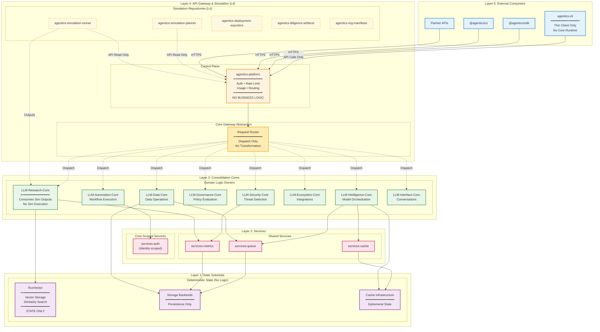
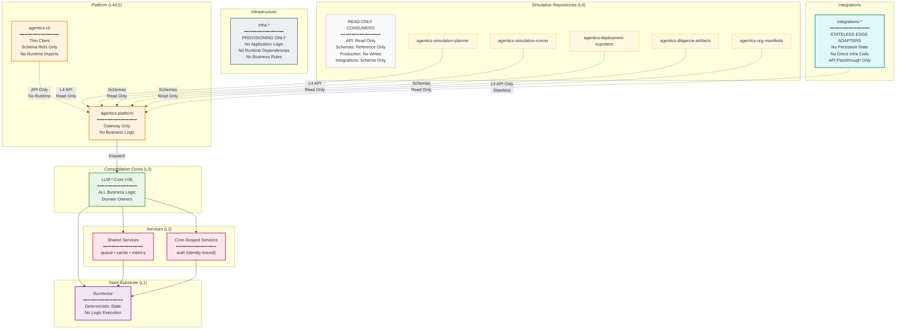
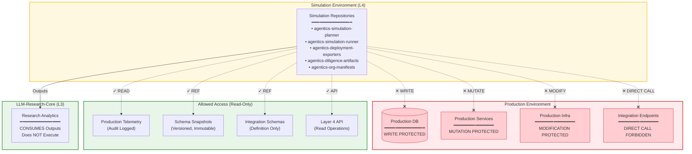
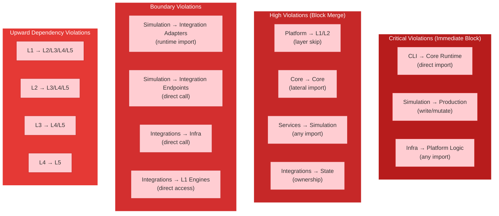
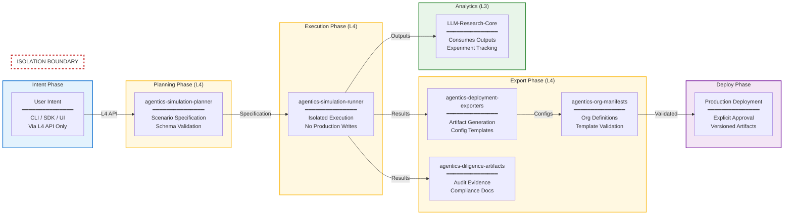
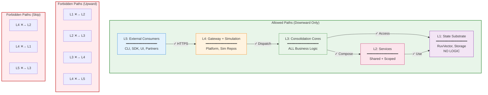
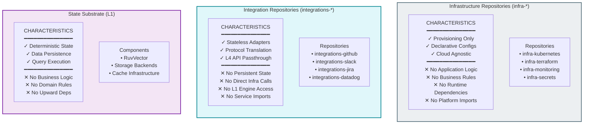

# Dependency Diagram

**Version**: 1.1
**Status**: Canonical
**Classification**: Architecture Visualization
**Last Updated**: 2025-01-03
**Canonical Reference**: [`DEPENDENCY_GRAPH.md`](DEPENDENCY_GRAPH.md)

---

## Purpose

This document provides a static, human-readable visualization of the Agentics platform dependency graph. The diagrams represent existing architectural rules as documented in [`DEPENDENCY_GRAPH.md`](DEPENDENCY_GRAPH.md) without adding or redefining rules.

All constraints shown are **strict and enforced**. Violations represent architectural failures.

---

## Platform Dependency Diagram



---

## Repository Class Diagram (Strict Boundaries)



---

## Simulation Isolation Diagram



---

## Forbidden Path Visualization (Complete)



---

## Intent → Simulation → Export → Deploy Flow



---

## Layer Dependency Matrix (Strict)



---

## Infrastructure & Integration Constraints



---

## Cross-Class Dependency Matrix

```
From ↓ / To →       │ CLI │ Platform │ Cores │ infra-* │ services-* │ integrations-* │ simulation │ substrate │
────────────────────┼─────┼──────────┼───────┼─────────┼────────────┼────────────────┼────────────┼───────────│
CLI                 │  -  │    ◇     │   ✕   │    ✕    │     ✕      │       ✕        │     ✕      │     ✕     │
Platform            │  ✕  │    -     │   ✓   │    ✕    │     ✕      │       ✕        │     ✕      │     ✕     │
Cores               │  ✕  │    ✕     │   ✕   │    ✕    │     ✓      │       ✕        │     ✕      │     ✓     │
infra-*             │  ✕  │    ✕     │   ✕   │    ✓    │     ✕      │       ✕        │     ✕      │     ✕     │
services-*          │  ✕  │    ✕     │   ✕   │    ✕    │     ✓      │       ✕        │     ✕      │     ✓     │
integrations-*      │  ✕  │    ◇     │   ✕   │    ✕    │     ✕      │       ✓        │     ✕      │     ✕     │
simulation          │  ✕  │    ◇     │   ✕   │    ✕    │     ✕      │       △        │     ✓      │     ✕     │
substrate           │  ✕  │    ✕     │   ✕   │    ✕    │     ✕      │       ✕        │     ✕      │     -     │
────────────────────┴─────┴──────────┴───────┴─────────┴────────────┴────────────────┴────────────┴───────────┘

Legend:
  ✓  Allowed (within class or designated downward path)
  ✕  Forbidden (architectural violation)
  ◇  Allowed via Layer 4 API only (no direct import)
  △  Schema reference only (no runtime adapters)
  -  Self-reference (N/A)
```

---

## Diagram Source Files

| File | Format | Purpose |
|------|--------|---------|
| [`dependency-diagram.mmd`](dependency-diagram.mmd) | Mermaid | Full diagram source for tooling |
| This document | Markdown + Mermaid | GitHub-renderable diagrams |

---

## Rendering Instructions

### GitHub

GitHub renders Mermaid diagrams in Markdown files automatically. No additional tooling required.

### Local Rendering

```bash
# Install Mermaid CLI
npm install -g @mermaid-js/mermaid-cli

# Generate SVG
mmdc -i dependency-diagram.mmd -o dependency-diagram.svg

# Generate PNG
mmdc -i dependency-diagram.mmd -o dependency-diagram.png
```

### VS Code

Install the "Markdown Preview Mermaid Support" extension for live preview.

---

## Constraint Summary

| Component | Constraint | Enforcement |
|-----------|------------|-------------|
| CLI (`agentics-cli`) | Thin client, no core runtime imports | CI static analysis |
| Platform (`agentics-platform`) | Gateway only, no business logic | Code review |
| Cores (`LLM-*-Core`) | All business logic, no lateral imports | Build failure |
| Services (`services-*`) | No simulation imports | CI check |
| Substrate (L1) | State only, no logic, no upward deps | Static analysis |
| Simulation repos | Read-only API/schema consumers | Network isolation |
| Infrastructure (`infra-*`) | Provisioning only, no app logic | CI check |
| Integrations (`integrations-*`) | Stateless edge adapters, no state ownership | Code review |

---

## Document Governance

| Aspect | Policy |
|--------|--------|
| Canonical Source | [`DEPENDENCY_GRAPH.md`](DEPENDENCY_GRAPH.md) |
| Purpose | Visualization only; does not define rules |
| Updates | Must reflect DEPENDENCY_GRAPH.md changes |
| Ownership | Platform Architecture Team |

---

*This diagram visualizes rules defined in [`DEPENDENCY_GRAPH.md`](DEPENDENCY_GRAPH.md). It does not add or modify architectural rules. In case of discrepancy, DEPENDENCY_GRAPH.md governs.*
